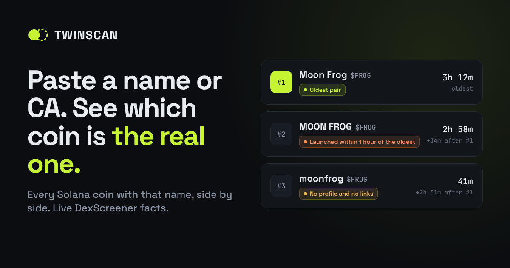

# TWINSCAN

**Paste a name or CA. See which coin is the real one.**

Copycat coins with the same name often launch within minutes of the original. TWINSCAN lists every Solana coin that shares a name or ticker, side by side and oldest first, using live DexScreener data. It shows facts, not scores.



## What it does

1. **One search box.** It takes a coin name, a `$TICKER`, a contract address (CA), or a pump.fun / Solscan link.
2. **Calls DexScreener from your browser.** It uses the public API directly, with no server and no API key.
3. **Lists every Solana coin with that name.** Each row shows:
   - pair age (oldest first), and how long after the oldest each coin appeared
   - market cap, 24h volume and 24h transactions
   - liquidity, capped at twice the SOL/USDC side of the pool so a faked price can't inflate it. Coins still on the pump.fun bonding curve show "on pump.fun curve" instead.
   - whether DexScreener has a profile, with website / X / Telegram links
   - the CA, with Copy, DexScreener and pump.fun buttons
4. **Flags facts:**
   - `Oldest pair`
   - `Only one with a profile and links`
   - `No profile and no links`
   - `Launched within 1 hour of the oldest`
   - `Same links as #N`: it lists a website or social that an older coin in the list already uses
5. **Share link.** The URL holds the search (`?q=POPCAT`), so people can post "which one" results. A **Copy summary** button also copies a plain-text summary for Telegram or X.
6. **Disclaimer.** It shows facts and cannot prove which coin the real team made.

Names match if they are equal after ignoring case, spaces, symbols, accents and a leading `$`. Coins that only *contain* the name are listed separately under "similar names".

## How it works

| Step | Endpoint | Why |
|---|---|---|
| CA lookup | `GET /token-pairs/v1/solana/{ca}` (falls back to `/latest/dex/pairs/solana/{addr}` for a pool address) | Get the name and ticker of a pasted CA |
| Find twins | `GET /latest/dex/search?q=…` × 4 variants (`term`, `$term`, `term sol`, `term pump`) | One search returns at most 30 pairs, and an established coin's own pools can fill them all. The variants find more clones. |
| Pair age | `GET /token-pairs/v1/solana/{ca}` for up to 24 twins | Search only returns some pools per coin. This gets each coin's first pool. |

A scan makes about 5–30 requests. DexScreener allows about 300 requests a minute per IP on these endpoints, and the page shows a clear message if that limit is hit.

**Limits:**
- Very crowded names can have more twins than DexScreener search returns. The page says so when a search hits the 30-pair cap.
- Brand-new pump.fun coins can take a minute to appear on DexScreener.
- Pair age is the age of the coin's first DexScreener pool, not its mint time.

## Run locally

No build step. Serve the folder with any static server (opening the file directly won't work, because the Content-Security-Policy only loads `app.js` from the page's own origin):

```bash
python3 -m http.server 8000
# open http://localhost:8000/?q=POPCAT
```

## Files

```
index.html   page, styles and content
app.js       search, grouping, flags, rendering (plain JS, no dependencies)
og.png       1200×630 social preview image
LICENSE      MIT
```

## Deploy

**GitHub Pages:** push to a public repo, then go to Settings → Pages → Build and deployment → *Deploy from a branch* → `main` / `(root)`.

**Cloudflare Pages:** create a project from the repo with no framework preset, an empty build command, and `/` as the output directory.

`og:image` and `twitter:image` in `index.html` point to `https://twinscan-app.github.io/og.png`. If you move the site to another domain, update them: X and Telegram ignore relative image paths.

## Launch config

Edit the `PROJECT` block at the top of `app.js`:

```js
const PROJECT = {
  ticker: 'TWINSCAN',
  ca: '',        // the coin's mint address
  x: '',         // https://x.com/…
  github: '',
};
```

The ticker chip and the coin panel (CA, Copy, **Buy on pump.fun**, Chart, "Scan for twins") stay hidden until `ca` holds a valid address, so the site never says "CA coming soon". The X and GitHub links appear once they are set.

> **Ticker note:** on 2026-10-25, DexScreener already listed at least 7 Solana coins with the ticker `TWIN` (the largest at about $184K market cap), and none named `TWINSCAN`. That's why the default ticker is `$TWINSCAN`. Re-check with the tool right before you launch.

## Launch checklist

- [ ] Search DexScreener (or this tool) for your name and ticker. Pick another if it's taken.
- [ ] Publish this repo (public, MIT) **before** launch.
- [ ] Deploy the site (live at https://twinscan-app.github.io/ once Pages is on).
- [ ] Put the website and X link in the pump.fun metadata fields.
- [ ] Launch, then set `PROJECT.ca` in `app.js` and push. The Buy link goes live.
- [ ] Lock the creator-fee share to your GitHub or X account, with admin revoked.
- [ ] Scan your own CA on the site and post the result.

## The coin

The tool is free and works the same for everyone. The coin is only the project's ticker. If it ever gets a real role, that role should ship as code in this repo that anyone can check.

## Disclaimer

TWINSCAN shows public DexScreener data. It cannot prove which coin the real team made, and nothing here is financial advice. Always check the team's own X or website for the CA.

## License

[MIT](LICENSE)
